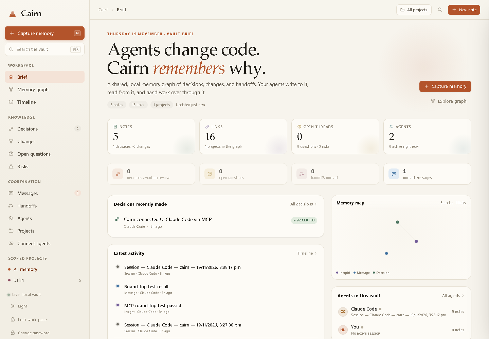
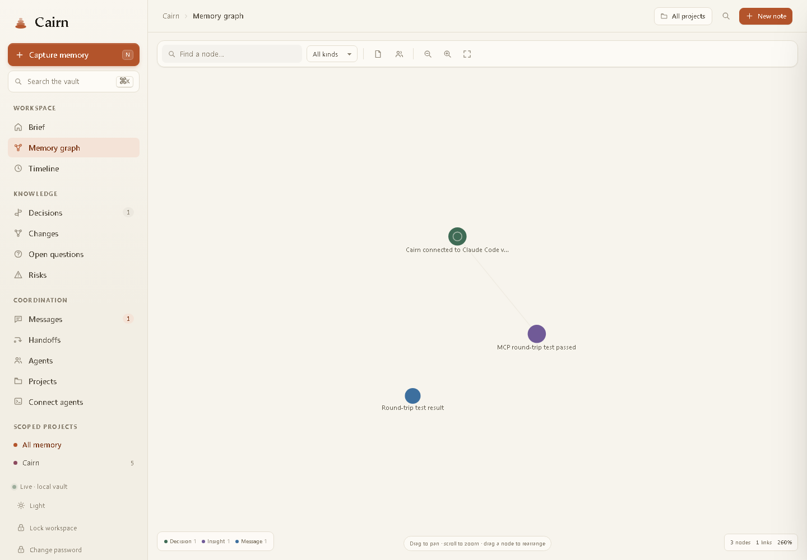
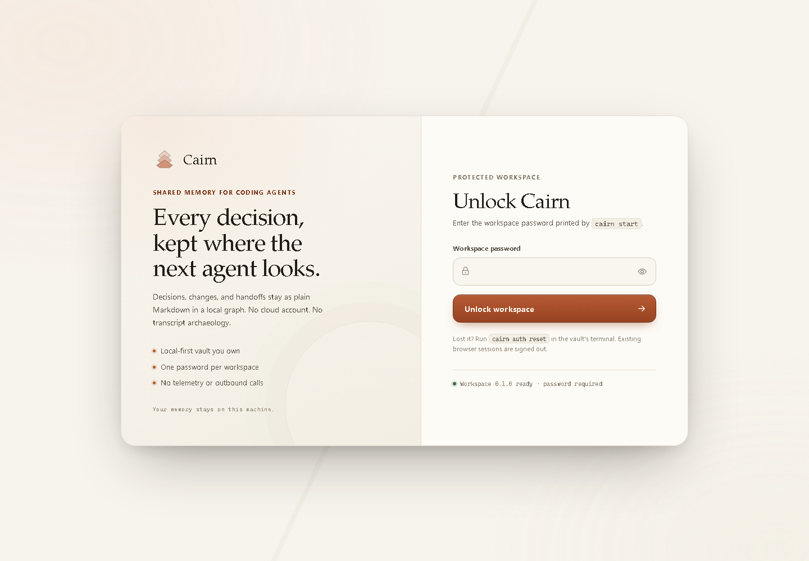
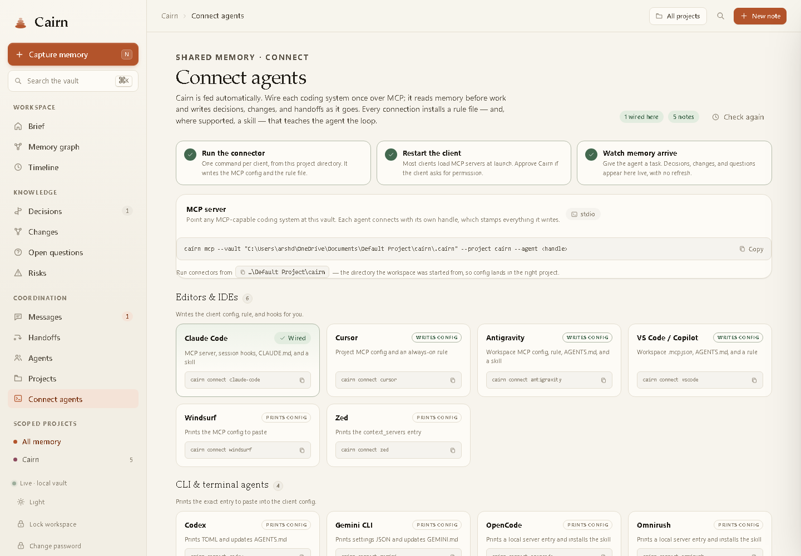

# Cairn

<div align="center">

**Shared Graph Memory for Coding Agents**

*Notion × Obsidian, but for AI agents. A local, zero-dependency MCP server that records every decision, change, and handoff in human-readable Markdown connected as a living knowledge graph.*

[](LICENSE)
[](package.json)
[](tsconfig.json)
[](scripts/check-portable.mjs)
[](Dockerfile)

[Quickstart](#quickstart) • [Why Cairn?](#why-cairn) • [Supported Agents](#supported-agents--ides) • [MCP Tools](#mcp-tools-reference) • [Web Workspace](#interactive-web-workspace) • [Cloud Deployment](#cloud--docker-deployment) • [Security](#security-posture)

</div>

---



## Why Cairn?

Every modern coding agent — **Claude Code, Cursor, Antigravity, Codex, Copilot, Windsurf, Zed** — boots into a fresh, isolated context every session. Without durable memory:

- **Tradeoffs are repeatedly relitigated** across chat sessions.
- **Code modifications land with zero recorded rationale** behind why architectural choices were made.
- **Context vanishes across agent handoffs** or between team members.
- **Project intelligence rots in chat scrollback** instead of remaining structured and durable.

**Cairn solves this with a shared memory vault per project, accessed by all agents:**

- 🧠 **Decisions** — What was chosen, why, alternatives rejected, and structured status (`proposed` ➔ `accepted` ➔ `superseded`).
- 🔄 **Changes** — Git commits, rolling worklogs, and captured file modifications with complete agent and session provenance.
- ❓ **Questions, Risks & Tasks** — Unresolved blockers, blast-radius warnings, and open threads that keep projects honest.
- 📨 **Agent-to-Agent Coordination** — Direct messages, broadcast announcements, unread inboxes, and structured work handoffs.
- 🕸️ **Living Knowledge Graph** — Backlinks, wikilinks, and typed edges (`implements`, `blocks`, `supersedes`, `touches`) visualized in real-time.
- 🔒 **100% Local & Human-Readable** — Your data is stored in plain Markdown files with YAML frontmatter. Open it in Obsidian, grep it, diff it in git, own it forever.

---

## Quickstart

Requires **Node.js 20+**.

### 1. Install the CLI

The npm names `cairn` and `cairn-memory` are taken by unrelated packages, so Cairn
installs straight from this repository. The installer builds from source with
Node/npm and puts a `cairn` command on your `PATH`:

```bash
# macOS / Linux
curl -fsSL https://raw.githubusercontent.com/Arshdeep-Yadav/Cairn/main/install.sh | sh
```

```powershell
# Windows PowerShell (do not use the `| sh` command here — Windows has no sh)
irm https://raw.githubusercontent.com/Arshdeep-Yadav/Cairn/main/install.ps1 | iex
```

The npm names `cairn` and `cairn-memory` belong to unrelated packages, and npm 12
blocks dependency install scripts, so the installer builds a local tarball instead
of relying on `npx cairn`. If you already have a checkout, the equivalent is:

```bash
npm ci
npm run build
npm install -g .
```

To update an installed CLI, run `cairn update` (set `CAIRN_REF` to pin a tag or
branch). It runs the installer bundled with your copy to fetch, rebuild, and reinstall the tarball;
your `.cairn/` vault is never touched.

To remove the CLI later: `curl -fsSL https://raw.githubusercontent.com/Arshdeep-Yadav/Cairn/main/install.sh | sh -s -- --uninstall`
(or `npm uninstall -g cairn-memory`). Your `.cairn/` vault is never touched.

### 2. Launch Cairn

Run from your project root. Cairn initializes a `.cairn/` vault if one doesn't exist,
starts the local workspace on `http://127.0.0.1:4242`, and prints a one-time password.

```bash
cairn
```

### 3. Wire Your Coding Agent in One Command

Connect Claude Code with automated session hooks and git commit tracking:

```bash
cairn start --connect claude-code --git-hooks
```

Connect other supported tools:

```bash
# Cursor IDE
cairn connect cursor

# Antigravity IDE
cairn connect antigravity

# VS Code / GitHub Copilot
cairn connect vscode

# Multiple tools at once
cairn connect claude-code cursor antigravity vscode
```

### 4. Check Workspace Status

```bash
cairn status
```

```text
Cairn 0.1.0 — status

  vault      /workspace/.cairn
  project    my-project
  memory     59 notes · 239 links · 4 projects · 6 agents

  MCP        cairn mcp --vault "/workspace/.cairn" --project my-project --agent <handle>
  workspace  http://127.0.0.1:4242 (running)
  auth       password protected
  wired      Claude Code / VS Code (.mcp.json), Claude Code hooks (.claude/settings.json)
```

---

## How It Works

```
 Claude Code ──┐                                   ┌──► 14 MCP Memory Tools
 Cursor      ──┤   MCP stdio / hooks   ┌────────┐  │
 Antigravity ──┼──────────────────────►│ cairn  ├──┼──► Interactive Web UI (Canvas Graph)
 Codex / IDE ──┘                       └───┬────┘  │
                                           │       └──► CLI Commands & Inspection
                                           ▼
                                 .cairn/notes/**/*.md
                             Markdown + YAML frontmatter
                             (Source of truth, Obsidian-compatible)
                                           │
                                           ▼
                                 Derived Graph Engine
                         (Wikilinks, Typed Edges, Backlinks,
                          File Overlaps, Agent Presence)
```

1. **Markdown is the Source of Truth**: Every note is written as `notes/<kind>/YYYY-MM-DD-<kind>-<slug>-<id>.md` with structured YAML frontmatter. You can hand-edit any file in your favorite text editor; Cairn updates its derived index automatically.
2. **Derived Knowledge Graph**: Wikilinks (`[[note-id]]`), typed relationships, and file references form a fast in-memory query graph with virtual nodes for projects, agents, sessions, and files.
3. **Automated Deduplication**: Deduplication keys prevent duplicate findings; commit captures fingerprint changeset SHAs; session-start reuses active connections.

---

## Supported Agents & IDEs

| Client | Category | What Cairn Installs / Wires |
|---|---|---|
| **Claude Code** | Terminal / Editor | Stdio MCP server, `SessionStart`, `PostToolUse` (worklog), `SessionEnd` hooks, `CLAUDE.md`, and agent skill |
| **Cursor** | IDE | `.cursor/mcp.json` configuration and always-on `.cursor/rules/cairn.mdc` rule |
| **Antigravity** | IDE | `.agents/mcp_config.json`, always-on rule, `AGENTS.md`, and native skill |
| **VS Code / Copilot** | IDE | Workspace `.mcp.json`, `AGENTS.md`, and agent rule |
| **Codex** | Terminal | Configuration TOML snippet and `AGENTS.md` instructions |
| **Gemini CLI** | Terminal | Settings JSON snippet and `GEMINI.md` memory rules |
| **Windsurf / Zed** | Editor | Formatted MCP stdio config snippet ready to paste |
| **OpenCode / Omnirush** | Terminal | Local MCP server entry and skill installation |
| **Generic MCP Client** | Universal | Universal stdio command snippet for any MCP-compliant harness |

---

## MCP Tools Reference

Cairn exposes **14 high-leverage MCP tools** and **2 living resources** over standard Model Context Protocol:

```bash
cairn mcp --vault .cairn --project <project> --agent <handle>
```

| Tool | Purpose |
|---|---|
| `memory_context` | The living brief: decisions in force, active proposals, open questions, risks, and recent changes. **Call this at session start.** |
| `memory_write` | Persist a note (`decision`, `change`, `insight`, `spec`, `risk`, `question`, `task`) with rationale, alternatives, tags, and files. |
| `memory_update` | Append or update note bodies, lifecycle statuses (`accepted`, `superseded`), tags, or relationships. |
| `memory_search` | Ranked BM25-style search across titles, bodies, tags, files, projects, and agents. |
| `memory_get` | Retrieve a complete note with body, forward links, backlinks, typed relations, and file path. |
| `memory_link` | Create typed edges (`implements`, `supports`, `contradicts`, `depends_on`, `blocks`, `answers`, `supersedes`). |
| `memory_graph` | Perform impact analysis and query graph topology around seed notes or search queries. |
| `memory_timeline` | Retrieve chronological activity grouped by day, filterable by project, agent, kind, or date window. |
| `memory_start_session` | Register agent session, mark agent online, and receive the living brief. |
| `memory_end_session` | Conclude session with summary and next steps; returns everything recorded during the turn. |
| `capture_changes` | Snapshot git working tree or commit as change memory with diff statistics and provenance. |
| `memory_send` | Send direct or broadcast messages (`to: "*"`) with priority flags and reply threading. |
| `memory_inbox` | Inspect unread messages and handoffs directed to your agent handle. |
| `memory_handoff` | Transfer unfinished work to another agent with structured next steps, files, and blockers. |

### MCP Resources
- `cairn://overview` — Global vault statistics, project roster, and active agent statuses.
- `cairn://projects/{project}/brief` — Scoped project brief with active decisions, risks, and handoffs.

---

## Interactive Web Workspace

Launch the built-in, zero-build web workspace:

```bash
cairn ui --open
```

<div align="center">
  
</div>

### Highlights:
- **Interactive Graph Canvas**: Force-directed layout visualizing decisions, changes, specs, agents, and files with collision-culled labels, zoom, and live search highlighting.
- **Living Brief Dashboard**: Instant overview of active decisions, attention items (unanswered questions, unresolved risks), recent commits, and online agents.
- **Scoped Projects**: Switch seamlessly between global vault memory and scoped project spaces with synchronized breadcrumbs.
- **Agent Coordination Center**: Real-time message inboxes, structured handoff boards, and live agent presence.
- **Omnibox & Quick Capture**: Hit `⌘K` (or `Ctrl+K`) for global search navigation; hit `N` to create a note from anywhere.
- **Live Sync**: Real-time Server-Sent Events (SSE) push updates instantaneously whenever an agent records memory via MCP.
- **Dark, Light & System Themes**: Clean, typography-first aesthetic with zero external UI bloat.

<div align="center">
  
  &nbsp;&nbsp;
  
</div>

---

## Cloud & Docker Deployment

Cairn is engineered to run anywhere — locally on your laptop, inside containers, or hosted on remote cloud instances.

### Quick Docker Run

```bash
docker run -d \
  -p 4242:4242 \
  -v cairn_data:/data \
  -e CAIRN_ALLOWED_HOSTS="cairn.example.com" \
  -e CAIRN_PASSWORD="YourSecurePasswordHere" \
  --name cairn \
  ghcr.io/arshdeep-yadav/cairn:latest
```

### Docker Compose with Automated HTTPS (Caddy)

```bash
# Clone the repository
git clone https://github.com/Arshdeep-Yadav/Cairn.git
cd Cairn

# Run with automated TLS
docker compose -f docker-compose.caddy.yml up -d
```

See [docs/cloud-deployment.md](docs/cloud-deployment.md) for full deployment guides covering **Fly.io, Railway, Render, and Linux VPS (systemd)**.

---

## Security Posture

- 🛡️ **Salted Scrypt Password Hashing**: Passwords are never stored in plaintext. They are scrypt-hashed with per-vault salts and dynamic timing attack protections.
- 🍪 **Hardened Session Cookies**: Signed `HttpOnly`, `SameSite=Strict`, 12-hour session tokens with in-memory server session invalidation and instantaneous revocation via **Lock workspace**.
- 🔒 **CSRF & Origin Protections**: Double-submit CSRF token validation on all mutations, strict `Origin` and `Sec-Fetch-Site` validation, and host allowlist enforcement defeating DNS rebinding.
- 🧹 **Automatic Secret Redaction**: Titles, note bodies, and diffs are scrubbed for API keys, private keys, AWS tokens, GitHub PATs, and credentials before writing to disk.
- 📁 **Path & Workspace Isolation**: `.env` files, credential stores, build directories, and binaries are strictly excluded from capture.

### Managing Passwords

```bash
# Check authentication status
cairn auth status

# Reset / rotate workspace password (invalidates all active sessions)
cairn auth reset

# Set custom password directly
cairn auth set-password "MyStrongSecretPass123"
```

---

## CLI Reference

| Command | Usage | Description |
|---|---|---|
| `cairn` / `cairn start` | `cairn start [--port 4242] [--no-open]` | Start workspace server and open in browser. |
| `cairn status` | `cairn status` | Print vault path, note counts, server status, and wired agents. |
| `cairn init` | `cairn init [--global] [--project name]` | Initialize a fresh memory vault. |
| `cairn mcp` | `cairn mcp [--vault path] [--project name]` | Start the Stdio MCP server for agent communication. |
| `cairn connect` | `cairn connect <client...>` | Automatically configure MCP and hooks for editors/agents. |
| `cairn skill` | `cairn skill [--install\|--print]` | Inspect or install agent instruction skills into workspace. |
| `cairn auth` | `cairn auth [status\|reset\|set-password]` | Manage workspace credentials and passwords. |
| `cairn capture-commit` | `cairn capture-commit [--commit ref]` | Capture git commit as structured change memory. |
| `cairn capture-file` | `cairn capture-file --path <file>` | Record file edit in rolling daily agent worklog. |
| `cairn doctor` | `cairn doctor` | Verify vault integrity and check for broken links. |

---

## Development

```bash
# Install dependencies
npm install

# Compile TypeScript
npm run build

# Run unit & integration test suite (29 tests)
npm test

# Verify zero-native-dependency contract
npm run check:portable
```

### Repository Layout
```text
src/
├── core/       # Markdown engine, graph indexer, store operations, auth & redaction
├── mcp/        # 14-tool MCP server & JSON-RPC stdio protocol handler
└── cli/        # CLI commands, client wiring connectors, and UI web server
web/            # Zero-build vanilla JS workspace UI (HTML/CSS/Canvas graph)
tests/          # Vitest end-to-end MCP, security, and integration tests
docs/           # In-depth architectural specifications & client guides
```

---

## Contributing

Contributions are welcome! Please check out [CONTRIBUTING.md](CONTRIBUTING.md) for local setup instructions, architectural principles, and testing guidelines before submitting a pull request.

Please note that this project is governed by our [Code of Conduct](CODE_OF_CONDUCT.md).

---

## License

This project is open source and available under the [MIT License](LICENSE).
